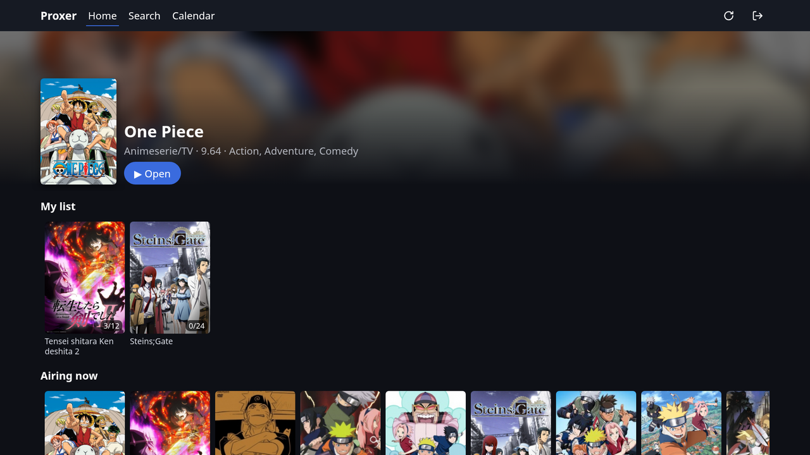
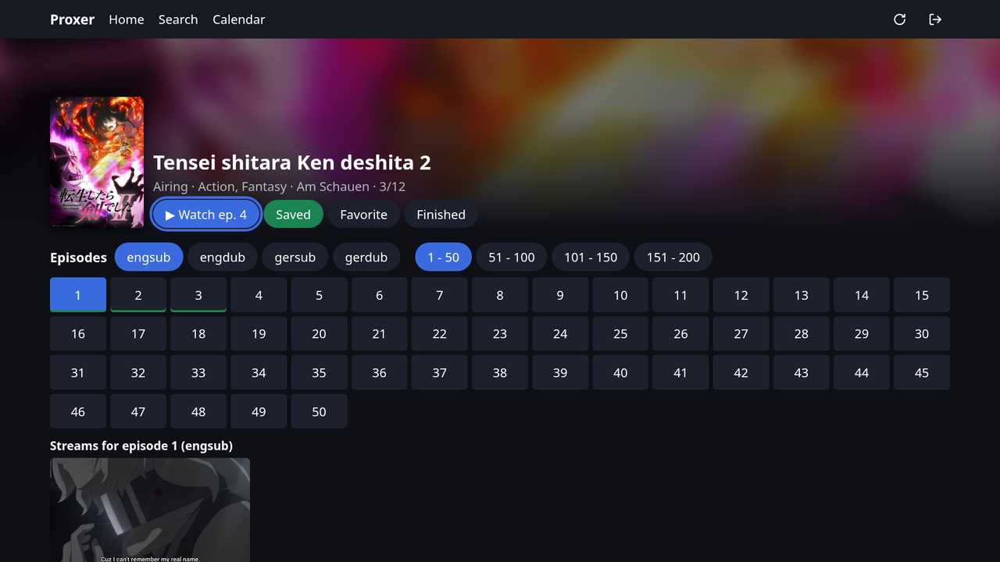
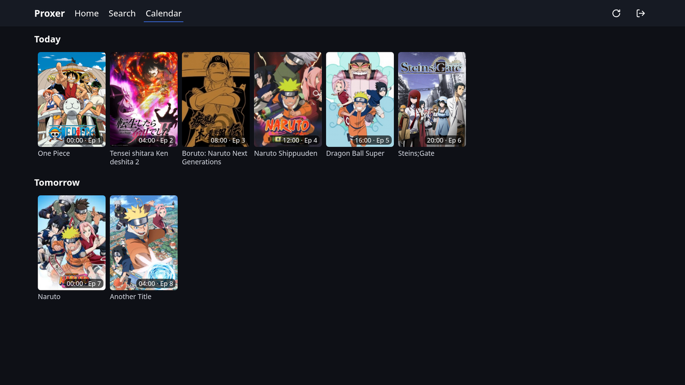
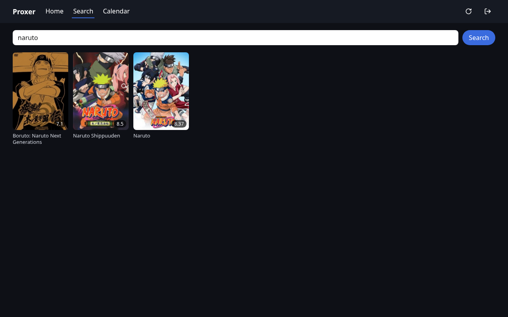
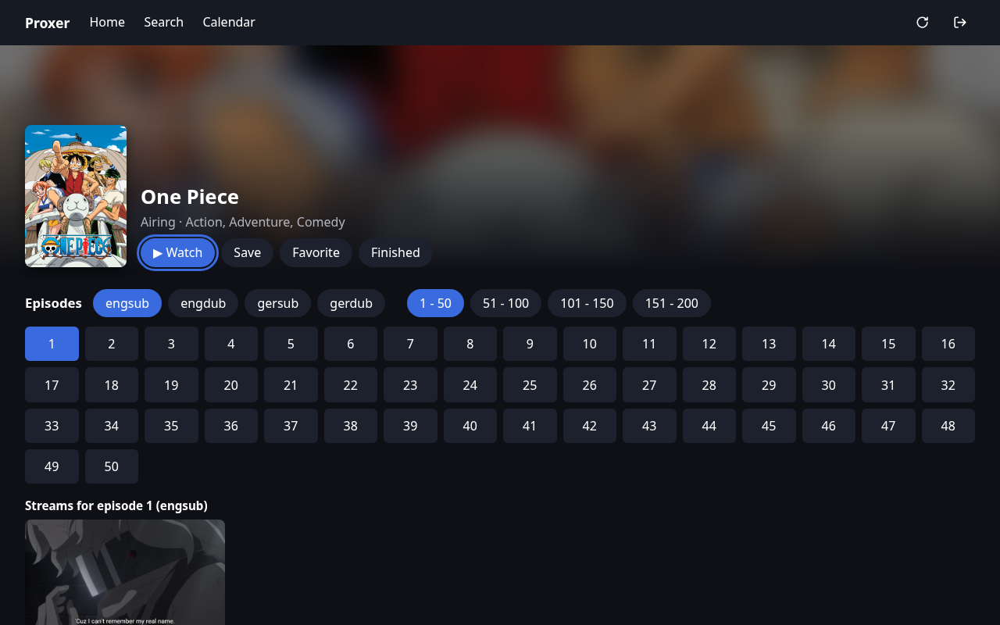
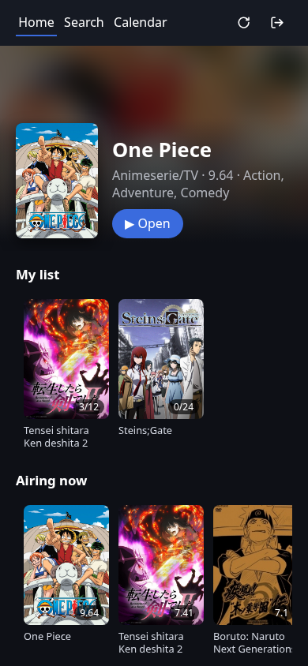
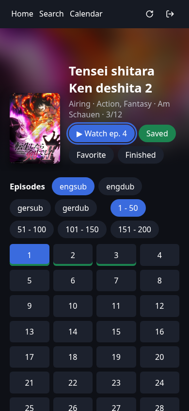
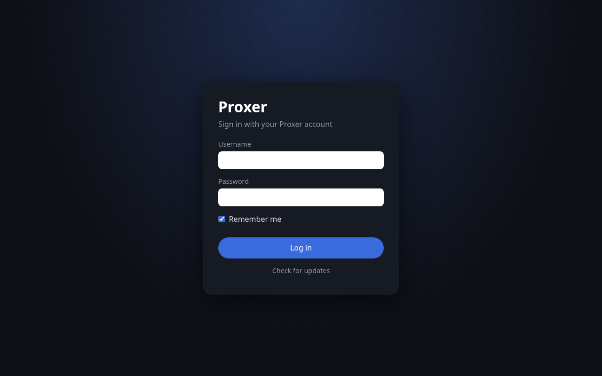

# prox

An unofficial app for [Proxer.Me](https://proxer.me) anime streaming on **Android TV**, **Android phones** and **Linux desktop**.
Built for the TV remote first (D-pad navigation, fullscreen player, Back button), and just as usable with touch or mouse.

> Not affiliated with or endorsed by Proxer.Me. You sign in with your own Proxer account; the app talks to proxer.me directly
> from your device. There is no server in between and no API key.



## Features

- **Home**: Recent (what you played in the app), My list (Am Schauen first, then Wird noch geschaut, with progress), Airing now, Top rated
- **Search** with cover grid and paging
- **Title page**: Watch continues at the next unwatched episode, Save / Favorite / Finished, list status, language and page chips,
  watched episodes marked, a preview frame for airing episodes, Watchlist (this / next episode)
- **Player**: Proxer's Normal and Airing streams, fullscreen (default on TV), seek with the remote, a Next-episode pop-up near the end,
  autoplay of the next episode, and the episode is marked watched in your Proxer list when it ends
- **Calendar**: Proxer's Anime-Countdown for the next 7 days, one row per day
- **Remote control**: spatial D-pad navigation, focus restored on Back, the on-screen keyboard opens only on Select
- **Self-update**: the update button (top bar, or on the login screen) installs the latest build from this repo's releases
- Saved login: OS keychain on desktop, an app-private file on Android

| Title page (TV) | Calendar (TV) |
|---|---|
|  |  |

| Search (desktop) | Title (desktop) |
|---|---|
|  |  |

| Phone: Home | Phone: Title | Login |
|---|---|---|
|  |  |  |

Screenshots use the built-in demo data, not a real account.

## Download

Releases (`build-<N>`) are published on [Forgejo](https://git.asteria.dog/asteria/prox/releases/latest) from a `build-<N>` tag
(see [Releasing](#releasing)) and mirrored to GitHub. The in-app updater reads the Forgejo releases. Latest build:

| Device | File |
|---|---|
| Android phones and most TVs (64-bit ARM) | [proxer-android-arm64.apk](https://github.com/Graphicscore/prox/releases/latest/download/proxer-android-arm64.apk) |
| Older Android TVs (32-bit ARM) | [proxer-android-armv7.apk](https://github.com/Graphicscore/prox/releases/latest/download/proxer-android-armv7.apk) |
| Android emulator (x86_64) | [proxer-android-x86_64.apk](https://github.com/Graphicscore/prox/releases/latest/download/proxer-android-x86_64.apk) |
| Linux (any distribution) | [proxer-linux-x86_64.AppImage](https://github.com/Graphicscore/prox/releases/latest/download/proxer-linux-x86_64.AppImage) |
| Debian / Ubuntu | [proxer-linux-amd64.deb](https://github.com/Graphicscore/prox/releases/latest/download/proxer-linux-amd64.deb) |

- **Android**: allow "Install unknown apps" for the app you open the APK with (browser, file manager). On a TV, a file manager or
  "Downloader" app does the job. Release APKs are signed with one fixed key, so later builds install over earlier ones; the in-app
  update button does that for you. A debug build installed earlier must be uninstalled once.
- **AppImage**: `chmod +x proxer-linux-x86_64.AppImage` and run it. The update button replaces the AppImage and restarts.
- The `.deb` does not update itself; install a newer one when the app reports an update.

## Build from source

Requirements: Rust (stable), Node.js 24, and for Linux the WebKitGTK 4.1 development packages
(`libwebkit2gtk-4.1-dev libsoup-3.0-dev libdbus-1-dev`). Android additionally needs JDK 21, the Android SDK and NDK 28.2;
see [docs/android-setup.md](docs/android-setup.md).

```sh
npm ci
npm run tauri dev                       # desktop app with hot reload
npm run tauri build                     # desktop release bundles
source scripts/android-env.sh
npm run tauri android build -- --apk --split-per-abi --target aarch64   # release APK (signing: docs/android-setup.md)
```

Tests and checks:

```sh
npm test               # frontend helpers (node --test)
npm run check          # svelte-check + TypeScript
cargo test --workspace # parsers, HTTP client, commands
```

UI work without a login: `npm run dev`, then open `http://localhost:1420/?demo&screen=home` (also `screen=search&q=naruto`,
`screen=title&id=53&pick=1`, `screen=calendar`, `screen=login`, and `&tv=1` for the TV layout). Demo data exists only in dev builds.

### Releasing

Pushes to `master` and pull requests are only built and tested. To publish, tag the commit with the next build number
(higher than the [latest release](https://git.asteria.dog/asteria/prox/releases/latest)) and push the tag:

```sh
git tag build-18 && git push origin build-18
```

CI builds that tag as version `0.1.18` and publishes release `build-18` with all five files; installed apps offer it as an update.

## How it works

- [Tauri v2](https://tauri.app) app: a Rust core and a [Svelte 5](https://svelte.dev) UI in the system WebView.
- `crates/proxer-parse` reads Proxer's HTML pages (search, lists, info, episodes, streams, calendar, your anime list) and the
  stream hosters' embed pages; `crates/proxer-client` is the logged-in HTTP client (cookie session, re-login, at most 2
  requests at a time). The official Proxer API is not used (it issues no new keys).
- Write actions (Save/Favorite/Finished, Watchlist, progress) use the same requests as the Proxer website, with the page token.
- `src-tauri` holds the Tauri commands, credential storage and the updater; `src` the UI; `fixtures` saved, scrubbed pages for tests.
- Design notes and implementation plans live in [docs/superpowers](docs/superpowers).
